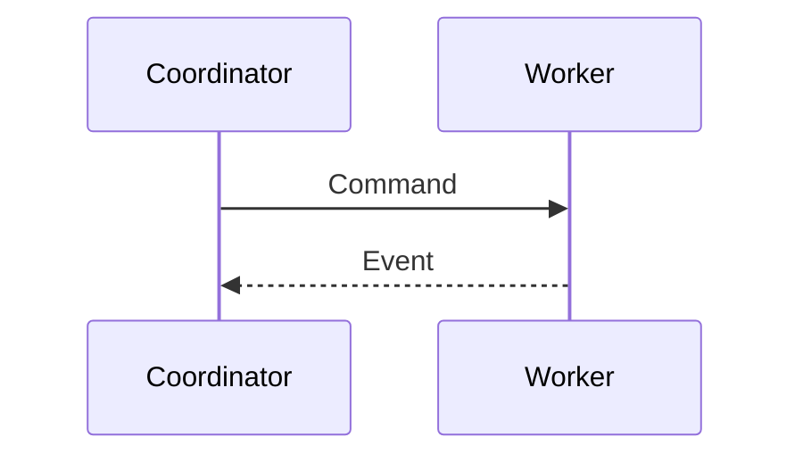

# NNNN: Title

- **Status:** Proposed | Accepted (YYYY-MM-DD) | Superseded by NNNN
- **Issue:** (the implementation issue's URL, once it exists)
- **Affects:** the paths it concerns, e.g. `src/execution/coordinator/`, `src/ui/app/program.tsx`

## Context

What is true today, and why it is a problem or a limit. Enough for someone who has not
seen the discussion.

## Goal

One feature or behaviour: what will be true afterwards.

### Non-goals

What this deliberately leaves out, and what stays as it is.

## Design

The concepts, the flow, and the interfaces that change. Where it sits in the onion
(domain or infrastructure), and the public interface of each module it touches.

### Failures and limits

What happens when a worker is gone, memory runs short, or input is empty.

### Compatibility

What changes for existing behaviour, settings, stored data, tests and tutorials. Is
it behind a setting, and what is the default?

### Workbench and docs

What the workbench shows of it, and what changes in `README.md` and the tutorials.

## Exit criteria

1. One falsifiable sentence, under stated conditions. Checked by: (a test, or a run).

## Alternatives considered

- **Alternative:** what it is, and why not.

## Open questions

Questions the user must answer before this is accepted. None, once it is.
