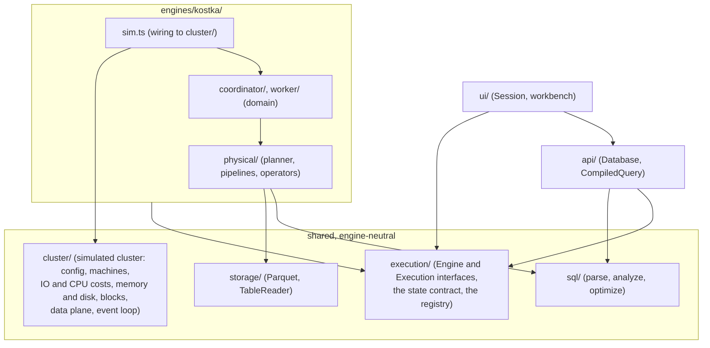
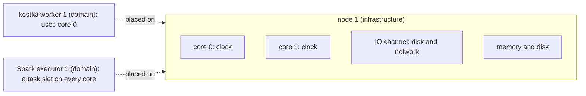

# 0001: Choose the engine a query runs on

- **Status:** Accepted (2026-11-26)
- **Issue:** https://github.com/pawojcik/kostka/issues/1
- **Affects:** `src/engine/` (renamed `src/api/`), `src/execution/`, `src/physical/`, `src/ui/session.ts`, `src/ui/app/` (the timeline among them), `test/`, `README.md`

## Context

kostka has one engine: the physical planner (`physical/`) cuts the optimized plan into
pipelines and output buffers, and a coordinator and workers (`execution/coordinator/`,
`execution/worker/`) run it on a simulated cluster (`execution/sim/`). We want a second
engine, modelled on Spark (stages and tasks; ADR 0002), planned from the same
optimized plan, running on the same simulated machines.

Today nothing separates the two concerns a second engine would need apart:

- `CompiledQuery.start()` calls kostka's planner and `new SimExecution()` directly.
- The simulated cluster (machines, clocks, IO pricing, memory and disk, the data
  plane) is written in kostka's terms: `MemoryPool` spills `LocalPiece`s of output
  buffers, `RunContext` implements the worker's `UnitContext` and prices kostka's
  splits, and `SimExecution` is both the event loop and kostka's wiring.
- `Execution.state(at)` returns kostka's objects (pipelines, splits, buffers), and
  `ExecEvent` has fields for them (`pipeline`, `split`, `buffer`, `partition`). The
  Session enriches the state with kostka's operators, and every workbench view reads
  those fields directly.
- `src/engine/` is not an engine: it is the application layer on top of the domain
  (`Database`: tables, loaders and queries; `CompiledQuery`: one query compiled, then
  started), and the name is wanted for what this ADR makes swappable.
- A worker is both the machine and the thing that runs work: it has one clock and runs
  one unit at a time. Spark's executor runs one task per core at once, and those tasks
  share the machine's disk, network and memory. Nothing today can model that.
- Shared things live in kostka's modules: the cost model (`physical/cost.ts`), row
  sizes (`physical/metrics.ts`), batches (`physical/batch.ts`), and the `TableReader`
  scans read Parquet files with (`physical/operators/scan.ts`).

## Goal

A query names the engine it runs on (`engine: "kostka"`, the default and, for now,
the only one), and everything a second engine needs from outside it is shared:
compilation up to the optimized plan, the simulated cluster, the Execution API, the
Session and the workbench's shell. The simulated cluster is made of **nodes**, each with
**cores**, and an engine places its own workers on them. kostka's engine works exactly
as today behind that seam: one worker per node, using one core.

### Non-goals

- The Spark-style engine itself and its views (ADR 0002).
- Any change to how kostka's engine plans, schedules, recovers or shows a query.
- An engine choice in the workbench's Options: there is only one engine until ADR 0002.
- kostka using more than one core, or placing several workers on one node. The model
  allows it; a later ADR can do it.
- A cores setting in the workbench's Options (ADR 0002, whose executors use every core).
- Sharing operator kernels (the hash table, aggregate functions, row comparison for
  sorting): they stay in kostka's operators until ADR 0002 gives them a second user.

## Design

### Modules

Modules by purpose, in onion layers. An engine is a domain (its physical plan, its
scheduler, its workers) on top of shared infrastructure, and nothing shared imports a
engine.



- **`src/cluster/`** (infrastructure, from `execution/cluster.ts`, `execution/sim/`,
  `execution/worker/memory.ts`, `physical/cost.ts`, `physical/metrics.ts`):
  - `config.ts`: `ClusterConfig`, IO profiles, CPU modes.
  - `node.ts`: a node (see Nodes and cores below) and where its time and bytes went;
    a **unit** of work laid out on one core's timeline as segments (CPU, storage,
    network, spill), with IO priced by the profile and CPU from the cost model or
    measured. This is the engine-neutral half of today's `RunContext`.
  - `memory.ts`: `MemoryPool`, holding named state and **blocks**; it spills blocks,
    not kostka's pieces.
  - `blocks.ts`: a node's local block store (a block: id, rows, bytes, spilled), and
    the data plane that reads a block from the node holding it (`BlockLostError` if
    that node is gone). kostka's pieces become blocks; Spark's shuffle files will be
    too.
  - `loop.ts`: the discrete-event loop. Events go through a queue ordered by simulated
    time; a core runs its next unit from the later of its clock and the unit's
    arrival; the earliest thing happens next (an event first on a tie). It records the
    history as steps, each with its messages and the nodes' frames.
    The history is shared by every engine: an engine's scheduler decisions and its
    units of work are steps of its own kinds, with its own `refs`. If an engine comes to
    need another shape of history, a later ADR splits it.
  - `cost.ts`, `rows.ts`: the CPU cost model and row sizes.
- **`src/storage/`** gets `TableReader` (reading a table version's Parquet files),
  which every engine's scan uses.
- **`src/api/`** (renamed from `src/engine/`): the application layer, `Database` and
  `CompiledQuery`, unchanged but for passing the engine choice through. `test/engine/`
  becomes `test/api/`.
- **`src/execution/`** (the seam): the `Engine` and `Execution` interfaces, the
  state contract, and the registry of engines.
- **`src/engines/kostka/`**: today's `physical/` and `execution/{coordinator,worker}`,
  and `sim.ts`, which wires its coordinator and workers to `cluster/` (today's
  `SimExecution` minus the event loop). Its behaviour does not change.

### Nodes and cores

A **node** is a simulated machine: infrastructure. It has **cores** (`cores` of them), one IO
channel (its disk and network bandwidth), and its memory and disk. A core is a lane of
CPU time with its own clock; it runs one unit at a time, and time is tracked per core. A **worker** (kostka) or an
**executor** (Spark) is a domain object the engine places on a node. It decides which
of its units runs on which of the node's cores and knows nothing of clocks. How an
engine thinks of cores is its own: Spark's executor offers one task **slot** per core
(ADR 0002); the cluster knows only cores.



How a unit is timed on a node:

- CPU segments run on the unit's core clock, so units on different cores overlap.
- Storage, network and spill segments also need the node's IO channel. A segment starts
  at the later of the core's clock and the time the channel is free, and holds the
  channel until it ends. The time spent waiting is a **wait** segment, so the cost of
  sharing bandwidth shows on the timeline.
- Reading a block from another node uses the reader's IO channel only, as today.
- Memory and disk belong to the node. How a node's memory is divided among the units
  running on it is the engine's choice (kostka: all of it to its one worker).

With one core in use nothing ever waits for the channel, so kostka's times are exactly
today's.

### The interfaces

```ts
// execution/engine.ts
interface Engine {
  readonly name: string;                  // "kostka"
  readonly label: string;                 // "kostka (pipelines)"
  /** Step kinds: who decides, how the workbench names them, what they mean. */
  readonly steps: readonly StepKindInfo[];
  /** Plans the optimized plan and starts an execution; nothing runs yet. */
  start(q: { optimized: PlanNode; reader: TableReader; cluster: ClusterConfig; settings: Record<string, unknown> }): Execution;
}

interface ExecEvent {                     // a step
  seq: number; ms: number; kind: string; text: string; node: number | null;
  /** What it is about, in the engine's terms: { pipeline: 2, split: 14 }. */
  refs: Record<string, number>;
  messages: readonly LoggedMessage[];
}

interface ExecState {                     // state(at): what every engine returns
  engine: string;
  at: number; events: number; event: ExecEvent; done: boolean; failed: { unit: string; error: string } | null;
  elapsed_ms: number; next: { node: number | null; kind: string; label: string } | null;
  cluster: ClusterConfig;
  /** Each node: up or gone, each core's clock, the IO channel, time by category,
   *  bytes, memory and disk. */
  nodes: NodeFrame[];
  /** Units of work on the cores' timelines, for the timeline and the trace. */
  units: { id: number; node: number; core: number; start_ms: number; end_ms: number; label: string; group: string; failed: string | null }[];
  result_rows: number;
  /** The engine's own objects: kostka's pipelines, splits, buffers, filters. */
  [key: string]: unknown;
}
```

`Execution` keeps its methods (`step`, `wave`, `runConcurrent`, `run`, `result`,
`rows`, `progress`, `elapsedNs`); `state(at)` returns an `ExecState`. `stopWorker(w)`
becomes `stopNode(n)` (a whole node is gone, with every core's unit), and `stopWorker`
stays as an alias.

```mermaid
sequenceDiagram
  participant S as Session / tests
  participant Q as CompiledQuery
  participant R as engines.get(name)
  participant E as Execution
  S->>Q: compile(sql, { engine, cluster, settings })
  Q->>Q: parse, analyze, optimize (shared)
  S->>Q: start()
  Q->>R: start({ optimized, reader, cluster, settings })
  R-->>Q: Execution (planned; nothing ran)
  S->>E: step() / run() / stopNode(n)
  S->>E: state(at)
  E-->>S: ExecState { engine: "kostka", ...shared, ...its own }
```

### Settings

`QueryOptions` gets `engine` (default `"kostka"`) and `settings` (the engine's own
planner settings). `planner` stays as an alias of `settings` for kostka, so existing
tests and code keep working. An unknown engine fails compilation with an error that
lists the engines there are.

`ClusterConfig.workers` becomes `nodes`, and it gets `cores` (cores per node, default
1); `memoryMB` and `diskMB` are per node. `workers` stays as an alias of `nodes`.

### The workbench

- The Session asks the engine for the state; kostka's enrichment (each operator's plan
  node, what it reads and writes, its role) moves from `Session.snapshot` into kostka's
  engine, given the map from plan nodes to ids.
- Shared views use only `ExecState`'s shared fields: the step banner and slider, the
  Plan and Result tabs, the Steps list (filtered by the engine's `steps`), the
  timeline and the trace (by `units`), and memory strips (by `nodes`).
- The timeline has a row per node and, inside it, a lane per core; a unit's segments
  are drawn in its core's lane, and a wait for the IO channel is hatched. With one core
  per node it looks as today. The node's memory strip sits under its lanes.
- Views of domain objects (Program, Query state, the workers' queues and caches) move
  to `ui/app/engines/kostka/`, and the query tab picks them by `state.engine`.
- Tutorials keep working: they read kostka's state, and run only on kostka.

### Failures and limits

None new: failures (a node gone, out of memory, out of disk) are raised and handled
as today. `BlockLostError` replaces `PieceLostError` under the same rule: reading a
block of a gone node fails the unit, which can run again.

### Compatibility

- Results, simulated times and every step's text stay the same for kostka.
- `src/engine/` becomes `src/api/` (`engine/node.ts` becomes `api/node.ts`, imported by
  tests, tools and the README's example).
- Paths change (`physical/` and `execution/coordinator|worker|sim` move under
  `engines/kostka/`); tests and `README.md` follow.
- `ExecEvent.pipeline`, `.split`, `.buffer` and `.partition` become `refs.pipeline`
  and so on; the workbench and tests that read them change with them.
- `ExecEvent.worker` becomes `node`, and `ExecState.workers` and `members` become
  `nodes`. `ClusterConfig.workers` and `stopWorker` keep working as aliases. In
  kostka's views a node still reads "worker 1": its worker is on node 1.
- No stored data changes.

### Workbench and docs

Nothing visible changes. `README.md`'s Layout, Physical planning and Execution sections
describe the seam, `cluster/` and kostka's engine under `engines/kostka/`; the
Execution API section documents `Engine`, `ExecState` and the registry.

## Exit criteria

1. For every query in `test/api/sql-vs-sqlite.test.ts` (today `test/engine/`), run with the cost model
   on 1, 3 and 4 nodes, the steps (kind, text, ms) and the result rows are the same
   before and after the change. Checked by: a fixture recorded from `main` before the
   change, and a test that compares against it.
2. All existing tests pass, changed only in import paths, `refs` and `worker` to `node`.
3. `compile(sql, { engine: "nope" })` fails with an error that names `nope` and lists
   `kostka`. Checked by: a test.
4. No file under `src/cluster/`, `src/execution/`, `src/api/`, `src/sql/` or
   `src/storage/` imports from `src/engines/`. Checked by: a test that reads the
   imports.
5. A test engine registered only in the tests (one unit per node, fixed rows)
   compiles, steps, runs, fails a stopped node's unit and returns its rows through
   `Database.compile` and the `Session`, with no kostka code involved. Checked by: a
   test.
6. `MemoryPool`, the block store and data plane, the node's unit timing and the
   event loop each have unit tests that use no engine. Checked by: the tests.
7. On a node with 2 cores, two units of CPU only, started together, end at the same
   time as one would alone; two units that each read 1 MB from storage take twice as
   long as one, the second showing a wait segment of the first one's IO time. Checked
   by: a unit test of `node.ts`.
8. kostka on `cores: 2` gives the same steps and rows as on `cores: 1`, using core 0
   only. Checked by: the golden fixture test, run with both.
9. Every `state(at)` has `engine` and the shared fields, and survives
   `structuredClone`. Checked by: the Session test.
10. The workbench looks and works as before with kostka: every tutorial runs to the end,
   and the Program, Query state, Workers, Steps and Trace tabs show the same as on
   `main` for SSB Q2.1. Checked by: a run in the browser.
11. The type check and `npm test` pass; `npm run build` succeeds; `README.md` is updated.

## Alternatives considered

- **Branch inside kostka's coordinator** (`if (engine === "spark")`). Least code, but
  two domains in one class, which is what the onion rule forbids, and neither could be
  read on its own.
- **A Spark engine written as a translation to kostka's pipelines** (stages as
  pipelines, tasks as splits). Little new code, but it would show kostka's model with
  Spark's names, not Spark's: no stage retries, no task slots, no shuffle files.
- **Keep the paths; add only `engines/spark/`.** Fewer moved files, but kostka would
  look like the engine and Spark like an add-on, and shared infrastructure would stay
  in kostka's modules (`physical/cost.ts`, `execution/sim/`).
- **Cores inside the engine's domain, nodes unchanged** (a Spark executor runs N
  tasks on one machine clock by itself). Less shared code, but then the two engines
  would price shared bandwidth differently, or Spark not at all, and the timeline
  could not show cores the same way for both.
- **No shared event loop: each engine writes its own simulation.** Simpler seam, but
  the two engines' times would not be comparable, which is the point of choosing
  between them.

## Open questions

None.
