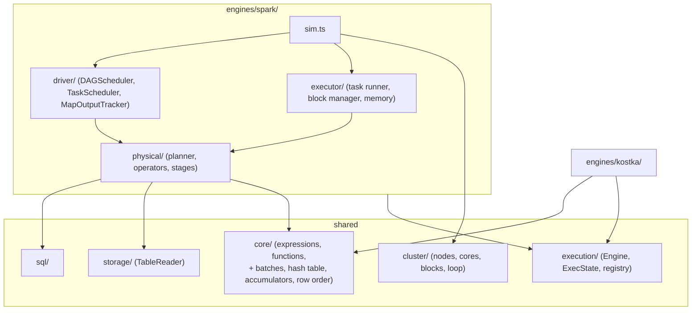
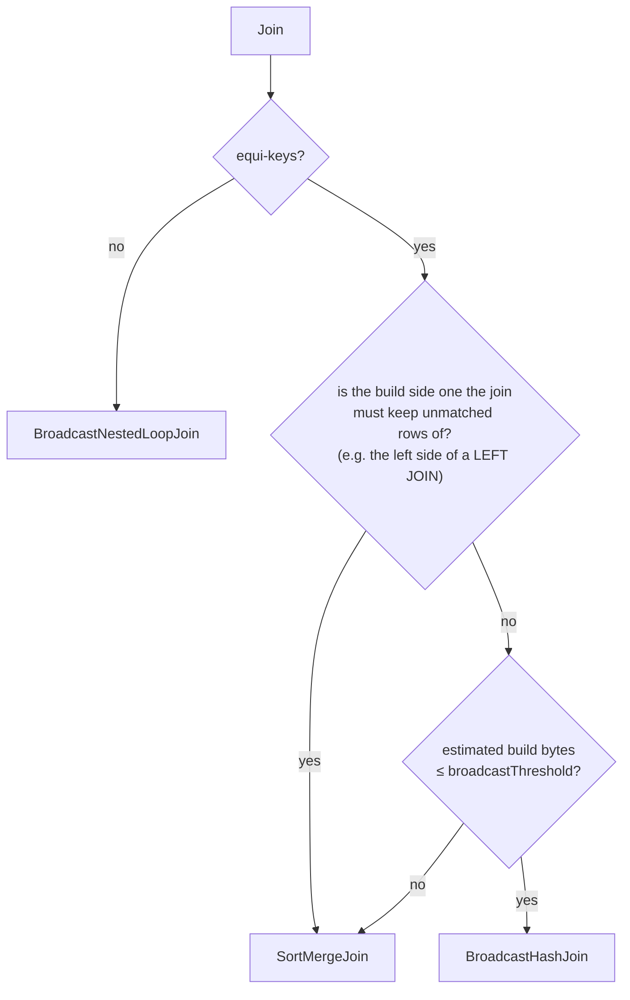
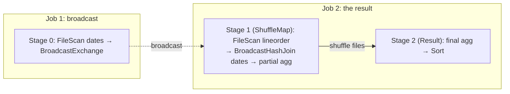
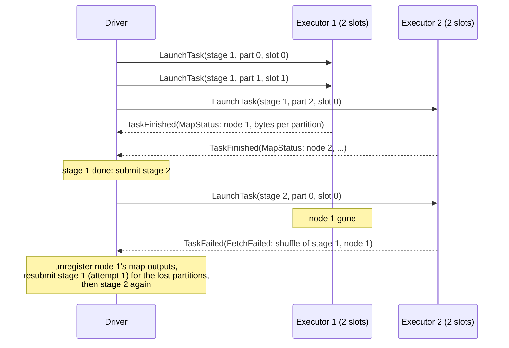

# 0002: A Spark-style engine, and its views in the workbench

- **Status:** Accepted (2026-11-26)
- **Issue:** https://github.com/pawojcik/kostka/issues/2
- **Affects:** `src/engines/spark/` (new), `src/engines/kostka/physical/operators/`, `src/core/`, `src/execution/` (the registry), `src/ui/app/` (Options, the query tab, `engines/spark/`), `src/ui/app/query.tsx`, `src/ui/app/tutorial.tsx`, `test/engines/spark/`, `test/api/sql-vs-sqlite.test.ts`, `README.md`

## Context

After ADR 0001, a query names its engine, and kostka is the only engine there is.
Everything an engine needs from outside comes from shared modules:
- compilation up to the optimized logical plan (`sql/`);
- `TableReader` (`storage/`);
- the simulated cluster of **nodes**, each with its **cores**, one IO channel, its
  memory and disk, the block store and data plane, and the event loop with its step
  history (`cluster/`);
- the `Engine`, `Execution` and `ExecState` contract (`execution/`).

kostka runs a query as pipelines and output buffers. Every worker has the whole plan
and runs splits of any pipeline, one at a time, on one core.

Most people who learn about distributed query engines meet Spark first. Spark cuts a
plan into **stages** at every shuffle and runs each stage as **tasks**, one per
partition, on executors with several cores. Spark's words (job, stage, task, attempt,
shuffle file, broadcast, executor lost, FetchFailed) do not map onto kostka's.
Comparing the two on the same query and cluster shows what each design costs:
- stage barriers against pipelines;
- shuffle files on disk against output buffers in memory;
- a broadcast threshold in bytes against kostka's cost rule;
- task retries and stage resubmission against kostka's recovery.

The operator kernels both engines need are inside kostka's operators
(`engines/kostka/physical/operators/`): the hash table, the aggregate accumulators,
comparing rows to sort them, and batches.

## Goal

A query can run on a Spark-style engine (`engine: "spark"`), planned from the same
optimized plan as kostka. It runs as jobs, stages and tasks on executors that use
every core of their node, and returns the same rows. The workbench lets the learner
choose the engine in Options. When Spark runs, the workbench shows Spark's own views:
the physical plan with its stages, the Jobs, Stages and Tasks pages, and the executors.
The views make it plain which engine ran.

### Non-goals

- Spark's adaptive execution (AQE), cost-based join reordering of its own, or
  bucketing. The shared optimizer's plan is used as it is.
- Range partitioning for ORDER BY, which needs a sampling job. A sort goes to one
  partition (see Planning).
- Speculative tasks, dynamic allocation (adding or removing executors), and Spark's
  unified memory manager (memory borrowed between tasks).
- Any change to kostka's planning, scheduling, recovery or views. kostka's golden
  fixture from ADR 0001 must still pass.
- kostka using more than one core.

## Design

### Modules

The engine is a domain of its own in `src/engines/spark/`, wired to `cluster/` like
kostka's. The two engines never import each other. What both need moves to `src/core/`,
which already holds expression evaluation and functions.



- **`core/`** gets `batch.ts`, `hash-table.ts`, `accumulators.ts` (aggregate state,
  partial and final) and `row-order.ts` (comparing rows for ORDER BY). They move out of
  kostka's operators, which then import them. kostka's behaviour does not change.
- **`engines/spark/physical/`** is the domain's plan: the Spark plan (operators), the
  planner that makes it from the optimized plan, and the cut into stages. It is pure
  and unit-testable.
- **`engines/spark/driver/`** is the domain's scheduler. It knows no rows except the
  result's.
- **`engines/spark/executor/`** is the domain's workers: one executor per node, with a
  task slot for each core.
- **`engines/spark/sim.ts`** wires the driver and executors to `cluster/`: it turns
  their commands into units on cores, and the cluster's events (a node gone) into
  theirs.

### Planning: from the optimized plan to the Spark plan

The planner maps each logical node to Spark-style operators. Then it adds an
**Exchange** wherever a child's partitioning is not what its parent needs, as Spark's
EnsureRequirements does.

| logical node | Spark operators |
|---|---|
| `Scan` | `FileScan` (one partition per Parquet file; pushed-down filters and columns) |
| `Filter`, `Project` | `Filter`, `Project` |
| `Aggregate` with group keys | `HashAggregate(partial)` → `Exchange hashpartitioning(keys, n)` → `HashAggregate(final)` |
| `Aggregate` without group keys | `HashAggregate(partial)` → `Exchange SinglePartition` → `HashAggregate(final)` |
| `Join` with equi-keys, small build side | `BroadcastExchange` (build side) + `BroadcastHashJoin` |
| `Join` with equi-keys, otherwise | `Exchange hashpartitioning(keys, n)` on both sides → `Sort` on both → `SortMergeJoin` |
| `Join` without keys (`cross`, or no equality in the condition) | `BroadcastExchange` (the right side) + `BroadcastNestedLoopJoin` |
| `Sort` | `Exchange SinglePartition` → `Sort` |
| `TopN` | `TakeOrderedAndProject` (top k in each task, then the top k of those in one partition) |
| `Limit` | `LocalLimit` → `Exchange SinglePartition` → `GlobalLimit` |

The choice of join:



- **Estimated build bytes** are the optimizer's estimated rows (`Estimator.rows`)
  times the row width from `cluster/rows.ts`. This is the same estimate kostka's cost
  model uses.
- **`broadcastThreshold`** defaults to **32 KB**. It is a fixed number of bytes, like
  Spark's `autoBroadcastJoinThreshold` (10 MB in Spark, scaled to kostka's
  megabyte-sized workers). `-1` turns broadcasts off.
- **Why 32 KB:** measured on the example queries, it gives a mix.
  - All taxi joins broadcast.
  - The sample's whole `users` table (about 55 KB) is shuffled.
  - At scale 0.1, about half the SSB and TPC-DS queries have a shuffle join. Several,
    like SSB Q4.1, have both kinds in one plan.

Operators are chained inside a stage, as Spark's **whole-stage code generation**
does. Each chain between Exchanges is one `WholeStageCodegen` box, and its operators
run batch by batch in one task. Nothing is generated: the name says what Spark would
do.

### Stages, tasks and jobs

- A **job** runs one action. The query's result is one job.
- Each `BroadcastExchange` is a **job of its own**, run before the job that uses it,
  as in Spark.
- The plan is cut into **stages** at each `Exchange`:
  - A **ShuffleMapStage** ends in an Exchange. Each of its tasks writes one **shuffle
    file**: rows sorted by reduce partition, with an index of where each partition
    starts. Spark calls this sort-based shuffle.
  - A **ResultStage** ends at the job's output. Its tasks send their rows to the
    driver.
- A stage has one **task** per partition:
  - one per file in a scan stage;
  - `shufflePartitions` in a stage that reads a hash Exchange;
  - one in a stage that reads a SinglePartition.
- `shufflePartitions` defaults to `"auto"`, 2 per core in the cluster (`nodes ×
  cores × 2`). The plan changes with the cluster, as kostka's does.
- A stage starts only when every parent stage is done. Stages are **barriers**: no
  data flows between them while the parent runs. Independent parent stages (the two
  sides of a SortMergeJoin) run at the same time.



### The driver and the executors

The **driver** (domain):
- **DAGScheduler:** makes the jobs and stages from the Spark plan. It submits a stage
  when its parents are done. It resubmits stages whose shuffle output was lost.
- **TaskScheduler:** gives a stage's tasks to free slots, one task per slot. It picks
  the executor with the most free slots first, and there is no data locality. A failed
  task runs again, up to `maxTaskFailures` = 4 attempts.
- **MapOutputTracker:** where each map task's shuffle file is (node, bytes per
  partition). Reduce tasks read from it.

The **executor** (domain), one per node:
- **task slots:** one per core of its node (Spark's `spark.task.cpus` is 1). A slot is
  Spark's idea, not the cluster's: the executor runs a task in a free slot, and slot
  *i* runs on core *i*, so the task's time is that core's.
- **block manager:** the node's shuffle files and the broadcast values it has fetched.
  A broadcast is fetched once per executor and turned into one hash table, which every
  task on that executor shares.
- **memory:** each running task gets a fixed share, `memoryMB / cores`.
  - A `Sort` that outgrows its share spills sorted runs to disk and merges them.
  - A `HashAggregate` or a hash table that does not fit fails the task with
    `OutOfMemoryError`.

Commands (driver → executor) and events (→ driver):

| command | |
|---|---|
| `LaunchTask` | stage, partition, attempt, slot; where its shuffle input is (from the MapOutputTracker); the broadcasts it needs |
| `RemoveShuffle`, `RemoveBroadcast` | free the files or value: no stage left reads them |

| event | |
|---|---|
| `TaskFinished` | a map task's **MapStatus** (its shuffle file: node, bytes per reduce partition), or a result task's rows; metrics |
| `TaskFailed` | an error, or **FetchFailed** (a shuffle file it read was on a node that is gone) |
| `ExecutorLost` | from the infrastructure: a node is gone, with its executor, its running tasks and its shuffle files |



### Time and the cluster

Tasks are units on cores (a slot's core), timed by `cluster/node.ts`:
- CPU comes from the shared cost model (or is measured).
- Reading Parquet, writing and reading shuffle files, and spilling are storage
  segments on the node's IO channel.
- Fetching a shuffle partition or a broadcast from another node is a network segment.
- Tasks on the same node share the IO channel. More cores speed up CPU work more than
  IO work, and the timeline shows the waits.

### Failures and limits

- **A node is gone:**
  - Its running tasks fail. These failures do not count toward `maxTaskFailures`, as
    in Spark, and the tasks run again on other executors.
  - Its shuffle files are lost. The driver unregisters them, and a reduce task that
    needed them fails with FetchFailed. The driver then resubmits the parent stage for
    the missing partitions only.
  - A stage is tried at most 4 times. After that the query fails, and the error names
    the stage.
- **No executors left:** the query fails with "every node is gone: no executor can run
  stage N".
- **A task fails 4 times** (out of memory, out of disk): the query fails.
  - The error names the task (stage, partition, attempt) and the error.
  - It also says what to do: for out of memory, give each node more memory, use fewer
    cores, or use more shuffle partitions.
- **Empty input:** a scan with no files has one empty task, so every stage has at
  least one task.

### Settings

`QueryOptions.settings` for Spark: `broadcastThreshold` (bytes, default 32768),
`shufflePartitions` (`"auto"` or a number), `maxTaskFailures` (default 4). `cores`,
`nodes`, `memoryMB` and `diskMB` come from `ClusterConfig` (ADR 0001). kostka's
`joinStrategy` and `runtimeFilters` do not apply to Spark and are not shown for it.

### Compatibility

- kostka is the default and unchanged: its golden fixture (ADR 0001) passes.
- kostka's operators import the moved kernels from `core/`; their results and costs
  stay the same.
- The sample gets a third example query, "orders from one city":
  ```sql
  select u.name, count(*) orders
  from orders o join users u on o.user_id = u.id
  where u.city = 'Gdansk'
  group by u.name
  ```
  Its build side is about 170 users (about 5 KB), so Spark broadcasts it, while it
  shuffles "revenue per city". The query does not change what kostka does.

### Workbench and docs

- **Options:**
  - An **Engine** choice at the top: "kostka (pipelines)" or "Spark-style (stages and
    tasks)".
  - A **Cores per node** input, shared by both engines.
  - Each engine's own settings below them.
  - The choice is part of the query's options, like the cluster.
- **Telling the engines apart:**
  - Spark's views use their own accent color.
  - The query tab's header says "Spark-style engine".
  - Step kinds use Spark's listener names: JobStart, StageSubmitted, TaskStart,
    TaskEnd, StageCompleted, JobEnd, ExecutorLost, FetchFailed, StageResubmitted.
- **Spark's views** (`ui/app/engines/spark/`), chosen by `state.engine`:
  - **Plan (physical):** the Spark plan in WholeStageCodegen boxes, grouped by stage,
    with Exchanges and BroadcastExchanges as the edges between stages. This takes the
    place of kostka's Program tab.
  - **Jobs / Stages / Tasks:** this takes the place of kostka's Query state tab.
    - Jobs: status, stages done out of all.
    - Stages: attempt, tasks done, running and failed out of all; input, shuffle
      read and shuffle write in bytes; and the time.
    - Tasks of a stage: partition, attempt, executor, slot, status, time, spill, and
      the error.
  - **Executors:** each executor's slots (busy or free, and with which task), memory
    per running task, shuffle files and broadcasts held, and failed tasks. This takes
    the place of kostka's workers' queues and caches.
- **Shared views:** the timeline (a lane per core, ADR 0001; a
  task's lane is its slot's core), the trace, Steps,
  Result and the logical plans work for both engines.
- **Tutorial:** one new tutorial, "Spark-style: stages, shuffles and slots", on the
  sample:
  - "revenue per city" shuffles, and "orders from one city" broadcasts;
  - raising the threshold makes the first one broadcast too;
  - with 2 cores, tasks run side by side and wait for IO;
  - stopping a node during the final stage shows FetchFailed and a resubmitted
    stage.

  kostka's tutorials run only on kostka. Starting one sets the engine to kostka.
- **`README.md`:** a "Spark-style engine (`engines/spark/`)" section covers planning,
  stages, the driver and executors, and recovery. The Workbench section describes the
  engine choice and Spark's views.

## Exit criteria

1. Every query in `test/api/sql-vs-sqlite.test.ts` returns SQLite's rows on
   `engine: "spark"` in each of these configurations: 1, 3 and 4 nodes; `cores` 1 and
   2; `broadcastThreshold` -1 (no broadcasts) and 1 GB (every join that can be
   broadcast is). Checked by: the configurations, added to that test.
2. On the sample with the default settings, "revenue per city" plans a SortMergeJoin
   with a hash Exchange on each side, and "orders from one city" plans a
   BroadcastHashJoin. On SSB at scale 0.1, Q4.1's plan has both. Checked by: a
   planner test.
3. A plan has one stage per Exchange plus one result stage per job, and one job per
   BroadcastExchange plus one. A scan stage has one task per file, a stage that reads
   a hash Exchange has `shufflePartitions` tasks, and one that reads a SinglePartition
   has one. Checked by: a planner test on SSB Q2.1 and TPC-DS q65.
4. No task of a stage starts before every task of the stage's parents has finished.
   Checked by: a test over the steps of every query in criterion 1.
5. With 1 node and `cores: 2`, at most 2 tasks run at once. A scan stage of 4 files
   with `io: "none"` and `cpu: "model"` takes at most 60% of its time with `cores: 1`. Checked by: a test.
6. Stopping a node at each of 20 evenly spaced steps (3 nodes) gives the same rows as
   with no failure. When a stopped node held shuffle files a later stage needed, the
   steps show FetchFailed and a resubmitted stage with attempt 1. Checked by: a
   recovery test on SSB Q2.1 and the sample's "revenue per city".
7. A query whose hash aggregate needs more than `memoryMB / cores` fails after 4
   attempts of the same task. The error names the stage, partition and attempt, and
   suggests more memory, fewer cores or more shuffle partitions. Checked by: a test.
8. A sort larger than its task's memory spills (the task's spill bytes are > 0) and
   returns SQLite's rows. Checked by: a test.
9. kostka's golden fixture from ADR 0001 still passes, and kostka's operators get their
   kernels from `core/`. Checked by: the fixture test.
10. No file under `src/engines/spark/` imports from `src/engines/kostka/`, nor the other
    way round. Checked by: the import test of ADR 0001, extended.
11. In the browser:
    - With Spark-style chosen in Options, SSB Q2.1 at scale 0.01 runs to the end. The
      Plan tab shows WholeStageCodegen boxes and Exchanges grouped by stage. The Jobs,
      Stages and Tasks pages and the Executors view fill in step by step.
    - With `cores: 2`, the timeline shows two lanes per node.
    - Stopping a node during the final stage shows FetchFailed.
    - The new tutorial runs to the end, and switching back to kostka shows kostka's
      views.

    Checked by: a run in the browser.
12. The type check and `npm test` pass; `npm run build` succeeds; `README.md` is updated.

## Alternatives considered

- **One task per row group instead of per file.** It gives more parallelism on big
  files, but the example datasets have few, small files. One task per file matches
  Spark's view of small files and keeps the task count easy to explain.
- **Range partitioning for ORDER BY.** This is what Spark does, but it needs a
  sampling job before the sort, which adds a job that teaches little here. One
  partition is honest about the cost, and the Stages page shows it.
- **Spark's unified memory manager** (tasks borrow memory, and storage memory gives
  way). It is more faithful, but its behaviour depends on timing and is hard to follow
  on a timeline. A fixed share per task makes "more cores, less memory per task" plain.
- **Reuse kostka's coordinator with a stage policy.** Less code, but stages, attempts,
  shuffle files and FetchFailed have no place in kostka's QueryState. That would put
  two domains in one, which ADR 0001 rejected.
- **kostka's relative join rule for Spark.** It is consistent with kostka, but Spark's
  rule is a size threshold, and the contrast between the two rules is part of what the
  learner should see.
- **Push-based or pipelined shuffle.** Modern Spark can do this, but the barrier
  between stages is the classic model and the clearest contrast with kostka's
  pipelines.

## Open questions

None.

## Corrections

### 2026-11-28: row widths, shuffle files on disk, and when FetchFailed shows

- **Assumed:** the estimated build bytes are `Estimator.rows` times "the row width
  from `cluster/rows.ts`", the same estimate kostka's cost model uses.
- **True:** row sizes are in `core/rows.ts` (ADR 0001's corrections moved them
  there), and they size rows that exist (`rowsBytes`), not a schema. kostka's join
  rule compares row counts only (`engines/kostka/physical/planner.ts`, `strategy`).
- **So:** `core/rows.ts` gets `fieldsBytes(fields)`: `ROW_OVERHEAD` plus a width per
  column type (8 for numbers, dates and timestamps, 1 for a bool, 16 for a string:
  4 plus an assumed 12 characters). Measured on the examples, this gives the mix the
  ADR describes: "revenue per city" builds about 63 KB (shuffled), "orders from one
  city" about 7 KB (broadcast), every taxi join broadcasts, SSB Q4.1 has both kinds,
  and 7 of the 13 TPC-DS queries have a shuffle join.

- **Assumed:** writing and reading shuffle files are "storage segments", and the
  cluster's memory can hold them.
- **True:** `storage` is shared table storage (`cluster/node.ts`); a node's local
  disk is the `spill_write` and `spill_read` segments. `MemoryPool.hold`
  (`cluster/memory.ts`) keeps a block in memory until memory runs short; it has no
  way to put a block on disk at once.
- **So:** a shuffle file is written to the node's local disk (a `spill_write`
  segment) and read from it (`spill_read`), plus network time from another node.
  `MemoryPool` gets `holdOnDisk`, which puts a block straight on the disk (and fails
  with `OutOfDiskError` if it doesn't fit). The Spark views call these "disk write"
  and "disk read".

- **Assumed:** the kernels both engines need are inside kostka's operators.
- **True:** the batch is `engines/kostka/physical/batch.ts`, outside `operators/`.
  kostka's coordinator also has `History<T>` (a value step by step,
  `coordinator/state.ts`), which the Spark driver needs too.
- **So:** `batch.ts` moves to `core/` as planned, and `History<T>` moves to
  `core/history.ts`: a second use. kostka's behaviour does not change.

- **Assumed (exit criterion 6):** when a stopped node held shuffle files a later
  stage needed, the steps show FetchFailed and a resubmitted stage.
- **True:** in Spark, `ExecutorLost` unregisters the node's map outputs at once. A
  stage that has not started yet sees its parent's missing outputs when it is
  submitted, and the parent is resubmitted first: no task fails a fetch. FetchFailed
  happens only to tasks of a stage that is already running.
- **So:** the driver does what Spark does. Agreed with the user, criterion 6 now
  reads: "Stopping a node at each of 20 evenly spaced steps (3 nodes) gives the same
  rows as with no failure. When a stopped node held shuffle files a later stage
  needed, the steps show a resubmitted stage with attempt 1, and FetchFailed when a
  stage reading those files was already running. Checked by: a recovery test on SSB
  Q2.1 and the sample's "revenue per city"."
